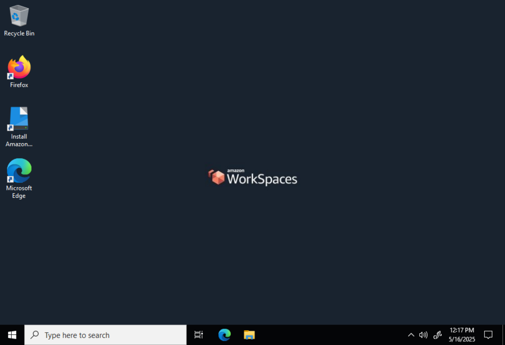
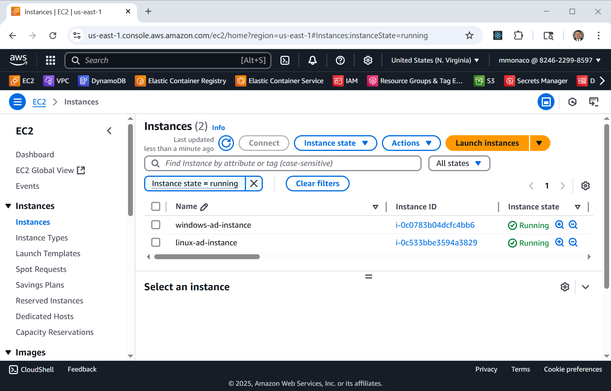
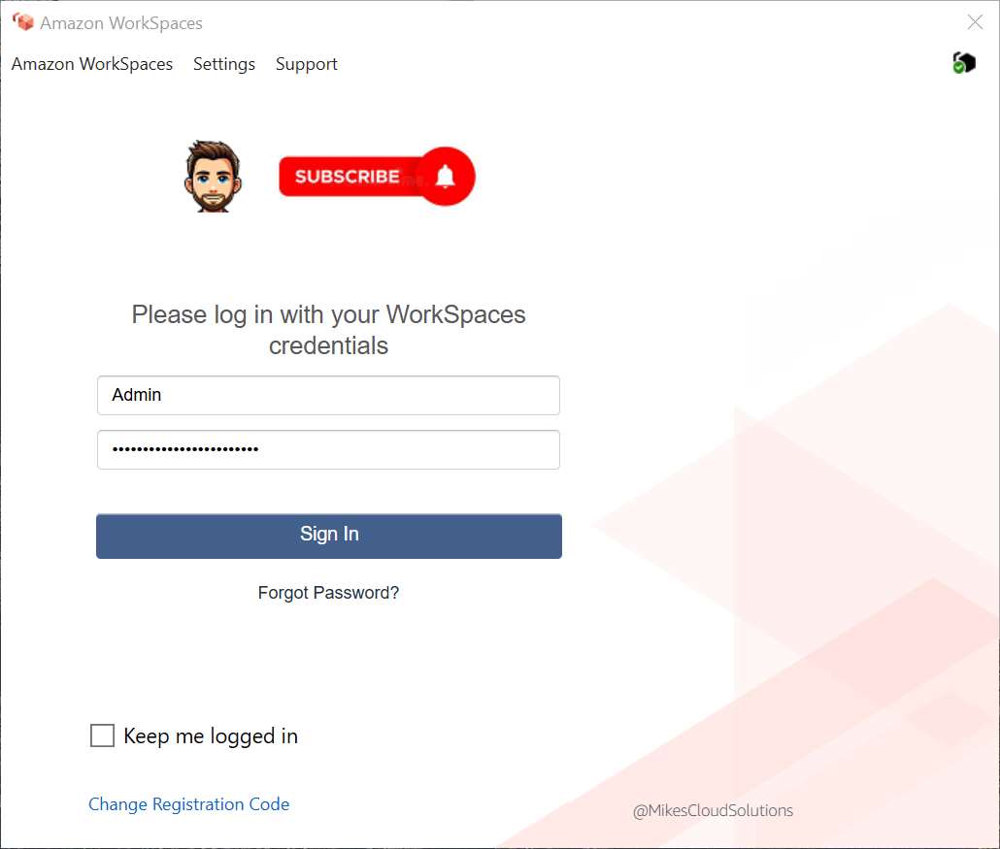

# Amazon WorkSpaces with AWS Managed Microsoft AD

A follow-up to the [AWS Directory Service](https://github.com/mamonaco1973/aws-active-directory)
lab ([video](https://youtu.be/1lnSxfFmGPY)). The same **AWS Managed
Microsoft AD** domain, `mcloud.mikecloud.com`, is registered with **Amazon
WorkSpaces**, and a Windows WorkSpace is provisioned for the domain's
`Admin` user. The Linux and Windows domain members move to **private
subnets** with no public IPs, so the WorkSpace is the way in: a cloud
desktop that works as a jump box for SSH and RDP inside the VPC.

The lab moves to **us-east-1**, because WorkSpaces isn't offered in
us-east-2 (see [WorkSpaces availability zones](https://docs.aws.amazon.com/workspaces/latest/adminguide/azs-workspaces.html)).



| Piece | Where | Role |
|---|---|---|
| **mcloud.mikecloud.com** | AWS Managed Microsoft AD, Standard | NetBIOS `MCLOUD`; two DCs in `ad-ws-private-subnet-1` and `-2` (`use1-az6`, `use1-az4`); the VPC's DHCP options point DNS at them |
| **WorkSpaces directory** | us-east-1 | the domain registered with WorkSpaces; every client type allowed; self-service for compute type, volume size, rebuild, restart and running mode |
| **Admin WorkSpace** | WorkSpaces | Windows bundle `wsb-fb2xfp6r8`, `VALUE` compute, 80 GiB root and 10 GiB user volumes, `AUTO_STOP` after 60 minutes |
| **linux-ad-instance** | `ad-ws-private-subnet-1` | Ubuntu 24.04, `t2.micro`; joins the domain with realm and SSSD; `linux-admins` get sudo |
| **windows-ad-instance** | `ad-ws-private-subnet-2` | Windows Server 2022, `t2.medium`; joins the domain, installs RSAT, and creates the lab's groups and users |
| **Secrets Manager** | us-east-1 | `admin_ad_credentials_ws` and one `*_ad_credentials_ws` secret per user |
| **ad-ws-vpc** | `10.0.0.0/24` | a public NAT subnet and the two private subnets; NAT gateway for outbound traffic |
| **Client branding** | `brand.sh` | uploads `logo.png` and the login message `@MikesCloudSolutions` for every client type |

## Architecture

<picture>
  <source media="(prefers-color-scheme: dark)" srcset="architecture-dark.svg">
  
</picture>

Regenerate with `python3 make_diagram.py`.

- **`01-directory/`**: the VPC, subnets, NAT gateway and DHCP options, the
  passwords in Secrets Manager, and the managed directory.
- **`02-servers/`**: the two instances and their user data, their IAM role
  and security groups, and `workspaces.tf` (the WorkSpaces role, the
  directory registration and the Admin WorkSpace).
- **`brand.sh`**: imports the client branding for the directory.

## What is Desktop as a Service?

**Desktop as a Service (DaaS)** delivers virtual desktops from the cloud
instead of from physical PCs or a self-managed VDI stack. Users connect
from a native client or a browser; IT manages images, security and cost
centrally. **Amazon WorkSpaces** is AWS's DaaS: Windows or Linux desktops
that join your Active Directory, with encrypted storage and an auto-stop
mode that bills by the hour when idle desktops are stopped.

Typical uses are secure access for remote staff or contractors, short-lived
desktops for training or testing, seasonal capacity, and cutting desktop
patching and support.

## Users and groups

The Windows instance creates these at boot. Every user's primary
`gidNumber` is 10001 (`mcloud-users`).

| User | Groups | uidNumber |
|---|---|---|
| jsmith | mcloud-users, us, linux-admins | 10001 |
| edavis | mcloud-users, us | 10002 |
| rpatel | mcloud-users, india, linux-admins | 10003 |
| akumar | mcloud-users, india | 10004 |

| Group | gidNumber |
|---|---|
| mcloud-users | 10001 |
| india | 10002 |
| us | 10003 |
| linux-admins | 10004 |

The WorkSpace belongs to the directory's built-in `Admin` account, whose
password is in `admin_ad_credentials_ws`.

## Prerequisites

* [An AWS Account](https://aws.amazon.com/console/)
* [Install AWS CLI](https://docs.aws.amazon.com/cli/latest/userguide/getting-started-install.html)
* [Install Terraform](https://developer.hashicorp.com/terraform/install)
* [Install a WorkSpaces client](https://clients.amazonworkspaces.com/), or use the web client

If this is your first time watching our content, we recommend starting with
this video: [AWS + Terraform: Easy Setup](https://youtu.be/BCMQo0CB9wk).

## Deploy

```bash
git clone https://github.com/mamonaco1973/aws-workspaces.git
cd aws-workspaces
./apply.sh
```

`apply.sh` runs `check_env.sh`, then:

1. Applies **`01-directory`**: the network, the secrets and the managed
   directory. The directory takes **30 to 60 minutes**.
2. Looks up the directory ID and applies **`02-servers`** with it: the two
   instances, which join the domain from their user data, the WorkSpaces
   registration and the Admin WorkSpace.
3. Runs `brand.sh` to upload the client branding.

It ends by running `validate.sh`:

```
============================================================================
WorkSpaces Quick Start - Validation Output
============================================================================

NOTE: WorkSpaces Registration Code: SLiad+XXXXXX
NOTE: WorkSpaces URL:               https://us-east-1.webclient.amazonworkspaces.com/login

NOTE: Windows instance:             ip-10-0-0-200.ec2.internal
NOTE: Linux instance:               ip-10-0-0-150.ec2.internal
```

The directory in the console:


and the two private instances:



## Try it

1. Get the `Admin` password from the `admin_ad_credentials_ws` secret.
2. Open the WorkSpaces client (or the web client URL above) and enter the
   **registration code**. The branding from `brand.sh` shows on the sign-in
   screen:

   

3. Sign in as `Admin` and connect to the Windows WorkSpace.
4. From the WorkSpace, RDP to the **Windows instance** or SSH to the
   **Linux instance** by the private names `validate.sh` printed, as `Admin`
   or one of the users above (passwords in their `*_ad_credentials_ws`
   secrets).

## Teardown

```bash
./destroy.sh
```

`destroy.sh` destroys `02-servers` (including the WorkSpace), deletes the
five secrets without a recovery window, then destroys `01-directory`.

## Notes

- **Lab only.** The SSH and RDP security groups allow `0.0.0.0/0`; the
  instances have no public IPs, so in practice that means anything in the
  VPC, including the WorkSpace.
- The Linux instance has SSH password authentication turned on so AD users
  can sign in with their passwords.
- WorkSpaces bills per WorkSpace even in `AUTO_STOP` mode (a monthly
  storage fee plus hourly use), and the managed directory bills by the
  hour, so tear the lab down when you're done.
- The bundle ID is hard-coded; if AWS retires `wsb-fb2xfp6r8`, look up a
  current Windows bundle with `aws workspaces describe-workspace-bundles
  --owner AMAZON`.
